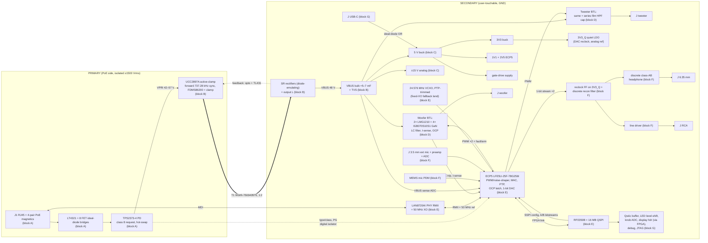

# Architecture — satellite board, variant A

Phase 1. Every block below becomes a schematic sheet and a placement region. Requirement numbers
(R-xx) refer to `design/intent.md`. Part choices marked **TBD (block X)** are made in that block's
audits in `design/parts/`.

## Block diagram

## Blocks

| Block | Contents | Sheet |
|---|---|---|
| A — PoE input | J1 RJ45 with integrated 4-pair PoE-rated magnetics (or discrete magnetics + RJ45), Bob Smith termination, two FET ideal-diode bridges, input TVS, TPS2373-4 PD with class 8 programming, primary bulk/input caps, digital isolator for PD status | `poe_in` |
| B — isolated converter | UCC2897A active-clamp forward controller, primary FET, clamp FET + cap, T1, secondary synchronous rectifiers with diode emulation / SR inhibit (R-33), output inductor, opto + TL431 feedback, VBUS bulk, VBUS TVS, Y-cap across the barrier | `iso_dcdc` |
| C — secondary rails | 5 V buck from VBUS; 3V3 buck; 1V2 FPGA core; gate-drive supply for LMG1210; 3V3_Q quiet LDO; ±15 V analog rails (topology choice per R-33a); USB/5 V ideal-diode ORing; power-good and sequencing | `rails` |
| D — GaN power stage ×2 | per channel: 2 × LMG1210 + 4 × Innoscience INN100 GaN, bootstrap, HF ceramics across each half-bridge, current sense, fast OCP comparator, LC output filter, optional post-filter sense divider, NTC near FETs and inductors; tweeter series film HPF cap; VBUS sense into an ADC | `amp_woofer`, `amp_tweeter` (same circuit), `vbus_sense` |
| E — compute and network | RP2350B + 16 MB QSPI flash + 12 MHz crystal; GW1NR-LV9QN88 (bitstreams held in the RP2350 flash and loaded over SSPI, for A/B); Ethernet PHY + 25 MHz crystal; audio clock | `mcu`, `fpga`, `ethernet` |
| F — analog audio | 1-bit DAC reclock flip-flop on 3V3_Q, discrete reconstruction filter, discrete class-AB headphone stage (R-13), line driver to RCA (R-14), MEMS PDM mic, ext-mic preamp with plug-in power (R-15) and its ADC, ESD on jacks | `audio_out`, `audio_in` |
| G — UI and I/O | USB-C (R-23), Qwiic with I2C buffer, LED 5 V level shifter + current limit (R-19), 8-pin ST7735S display header, signals on FPGA I/O, GND/VCC on solder jumpers (R-20), knob header with RC filters, Raspberry Pi Debug Probe header, FPGA JTAG header, test points, PTP-second test point | `io` |

## Rails (net names)

| Net | Side | Source | Notes |
|---|---|---|---|
| `VPOE_A`, `VPOE_B` | primary | pair-set centre taps, before the bridges | |
| `VPRI` / `VPRI_RTN` | primary | after the PD hot-swap FET | primary 42–57 V and its return |
| `GND` | secondary | — | single solid plane; all secondary returns |
| `VBUS` | secondary | ACF output | 48 V amp rail |
| `+5V`, `+3V3`, `+1V2`, `+3V3_Q`, `+15V`, `-15V`, `VDRV` | secondary | block C | `VDRV` = LMG1210 supply |
| `VUSB` | secondary | USB-C | ORed into `+5V` |

## Architecture decisions (logged in `decisions.md`)

1. **RP2350B (QFN-80)**, not RP2350A: the FPGA link, SSPI config, 8 ADC inputs (knobs, NTCs), I2C,
   LED data/clock, encoders, UART, USB and spare pins don't fit the A's 30 GPIO.
2. **The FPGA has no flash of its own.** The RP2350 loads its bitstream over SSPI from the 16 MB
   QSPI flash, so A/B images and rollback for both chips live in one place (R-56).
3. **The PHY talks RMII to the FPGA**, which hosts the MAC and the PTP timestamps (R-55). Frames
   go to and from the RP2350 over the FPGA link. The link's choice (QSPI-style, PIO 8-bit parallel,
   or SPI) and its bandwidth calculation belong to block E.
4. **PD status crosses the barrier through one digital isolator** (R-32a); the converter's
   feedback goes through the opto. Nothing else crosses.
5. **One GND plane on the secondary**, with the power stage placed so its return currents don't
   cross the analog region (decided in the phase 4 floorplan).
6. **Primary FET, clamp FET and SRs are silicon MOSFETs.** "All GaN" in R-02 covers the audio
   power stage. GaN in the converter is a possible later variant.

## Interfaces between blocks (what each audit must agree on)

- A → B: `VPRI` range 42–57 V (lower at the PD UVLO), PD power-good gating the UCC2897A start.
- A → E: isolated `PD_TPL`, `PD_TPH`, `PD_BT` (or the TPS2373-4 equivalents) and `PD_PG` into the FPGA.
- B → C/D: `VBUS` 48 V ± 2 % static, ≤ 10 % sag, TVS clamp below the 100 V GaN rating.
- C → D: `VDRV` per the LMG1210 datasheet; `+5V` budget per R-33a.
- D ↔ E: 8 PWM lines (HI/LO per half-bridge, or one PWM per half-bridge if LMG1210's
  single-input mode with programmable dead time is used — block D decides), 2 OC trip lines,
  current-sense and post-filter sense to ADCs, `VBUS_SENSE`.
- E → F: 2 × 1-bit DAC stream + bit clock; MEMS PDM data/clock; ext-mic ADC interface.
- E → G: I2C, LED data/clock, display SPI + BLK (from the FPGA), knob ADCs, SWD, UART, JTAG.

## Phase 1 reconciliation (2026-11-07)

The block audits in `design/parts/` change the architecture above as follows. Where this section
and the earlier text disagree, this section wins. Each `<X>-interfaces.md` holds the detail.

- **FPGA: Lattice ECP5 LFE5U-25F-7BG256I** (user). Slave-SPI configuration from the RP2350; A/B
  bitstreams in the RP2350's W25Q128 flash (decision 2 stands as first written). The Gowin files
  (`E-*gowin*`, `E-fpga-gw1nr9.md`) are kept, marked superseded. 6-layer board, no via-in-pad.
  PWM edge grid 1.695 ns (ODDRX2, ×12 gearing; 1.453 ns is a bring-up option only). Pin map:
  `E-pinmap.md` (109 balls used, 87 spare I/O), with each ball's required pre-configuration state.
- **RP2350↔FPGA link:** PIO 8-bit parallel bus at 37.5 MHz, 37.5 MB/s (82 % at the worst-case load).
- **PHY:** LAN8720AI (RTL8201F fails R-40, rated 0–70 °C), with its 50 MHz reference from an XO.
- **Audio clock:** 24.576 MHz VCXO trimmed by the FPGA, with a shared land for a 0.7 ps fixed XO
  (C5203547). An SN74LVC2G34 buffer on +3V3_Q feeds the DAC flip-flops and the PCM1808 straight
  from the oscillator, never through the FPGA.
- **Block A:** four centre-tap nets `POE_CT12/36/45/78`; `VPRI` is the bridge output; `VPD_N`
  (TPS2373 VSS); status to the FPGA is active-low `PD_TPH_N`, `PD_TPL_N`, `PD_BT_N`, `PD_PG_N`
  through an ISO7740 isolator powered from `VB_PRI`. The PD's PG doesn't fall on PoE loss: the
  secondary-side detector stays the main PoE-loss signal.
- **Block B:** 737.28 kHz crystal-synced (see the frequency plan); Würth 750343576 rewired 1:2
  (bought outside LCSC); NCP4306 zero-current SR control with RCD-Z clamps (no reverse power flow);
  secondary constant-current loop with `ILIM_SEL0/1` from the RP2350 (00 = 0.44, 01 = 0.94,
  10 = 0.80, 11 = 1.30 A) and `IBUS_SENSE` back; `POE_LOSS_N` input-voltage detector; bias rails `VB_PRI` (14.3 V)
  and `VSR`; CBULK on `VPRI` 61 µF; VBUS bulk 6 × 1000 µF 63 V EKZN.
- **VBUS overvoltage:** bulk absorbs regen (≤ 12.4 mJ, +0.04 V); gateware stop at 55 V; converter
  OVP ≈ 53 V through the aux winding into LINEOV; SMCJ51A at the bulk and SMBJ51A at each bridge.
- **Block C rails:** `+5V_BUCK` (LM5013, LEDs) and `+5V` (TPS2116 priority mux with `VUSB`);
  `+3V3` and `+1V1` (TPS62A02A); `+2V5` (TPS7A9401); `+3V3_Q` (TPS7A9401, enable
  gated by ±15 V power-good); `+3V3_A` (TPS7A2033, block D sensing); `VDRV` 7.0 V (LM5017);
  `+15V`/`-15V` from an LM5017 Fly-Buck at +18/−17.4 V plus TPS7A4901/TPS7A3001 LDOs, 120 mA
  per rail; `+5V_A` from +15 V for the mic ADC and bias. `+1V2` and `+1V8` are withdrawn.
- **Block D:** IGB070S10S1 GaN (user, 2026-11-08), with an IGC033S10S1 fallback courtyard at each site; LMG1210 in PWM mode (one PWM per half-bridge, 20 ns dead-time setting, ≈ 18 ns
  effective); 576 kHz baseline (768 kHz option); 8–92 % duty clamp; latched OCP at 15 A ± 1 A (≤ 250 ns)
  plus a differentiator hard-short detector (≤ 100 ns); NTCs,
  VBUS sense and current sense on ADS7038 / ADS8353 ADCs read by the FPGA; post-filter sense fitted;
  tweeter series cap 2 × 22 µF polypropylene. 27 FPGA signals (20 used, 7 reserved).
- **Block F:** 4-tap FIR 1-bit DAC (74LVC74A) at 6.144 Mb/s; SA5532 filter and drivers; BCP56/53
  headphone stage; HFD4 relay mute; PCM1808 mic ADC; T3902 PDM MEMS mic. Gateware holds the DAC
  lines low until `PG_3V3Q` (ball B5) is high; relay enables drop ≤ 1 ms after PoE loss.
- **Block G:** USB-C (HRO TYPE-C-31-M-12); Qwiic with TCA9617B and a TPS2553 switch; LED out with
  a TPS2553 (≈ 1.1 A) and SN74LV1T125 shifters, JST PH 4-pin; display header with 24 solder jumpers
  and a FET-switched `DISP_BLK` driven by `DISP_BL_PWM` (ball G15); SH 3-pin Debug Probe headers;
  1×6 JTAG header.

### Frequency plan (2026-11-08)

| Source | Frequency | Notes |
|---|---|---|
| Amp PWM | 576 kHz (12 × 48 kHz) | ECP5 ×12 grid, 1024 steps |
| Isolated converter | 737.28 kHz ± 40 ppm | 7.3728 MHz crystal ÷ 10 into UCC2897A SYNC; free-runs 590–708 kHz if the clock fails, and the amp then mutes |
| 5 V buck (LM5013) | ≈ 200 kHz (170–230 kHz) | COT; ≥ 116 kHz from every low-order product |
| 3V3 / 1V1 bucks | ≈ 2.4 MHz | |
| Audio clock | 24.576 MHz VCXO | PTP-trimmed; fixed-XO fallback land |
| RMII | 50 MHz XO | |

Smallest product between the amp and the converter: 161 kHz.
